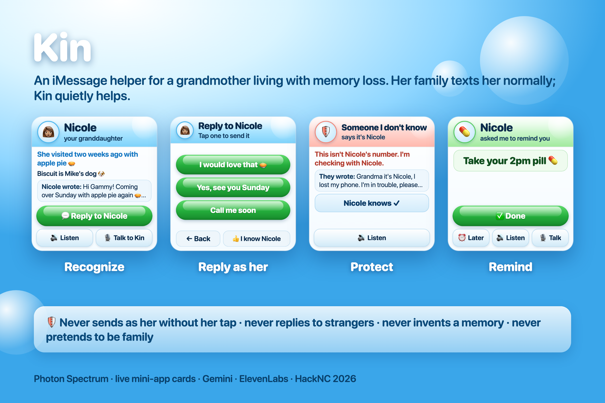
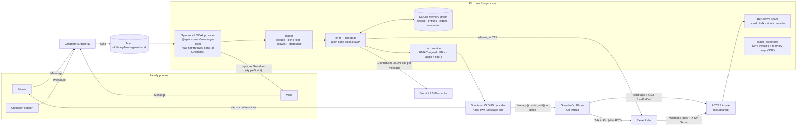
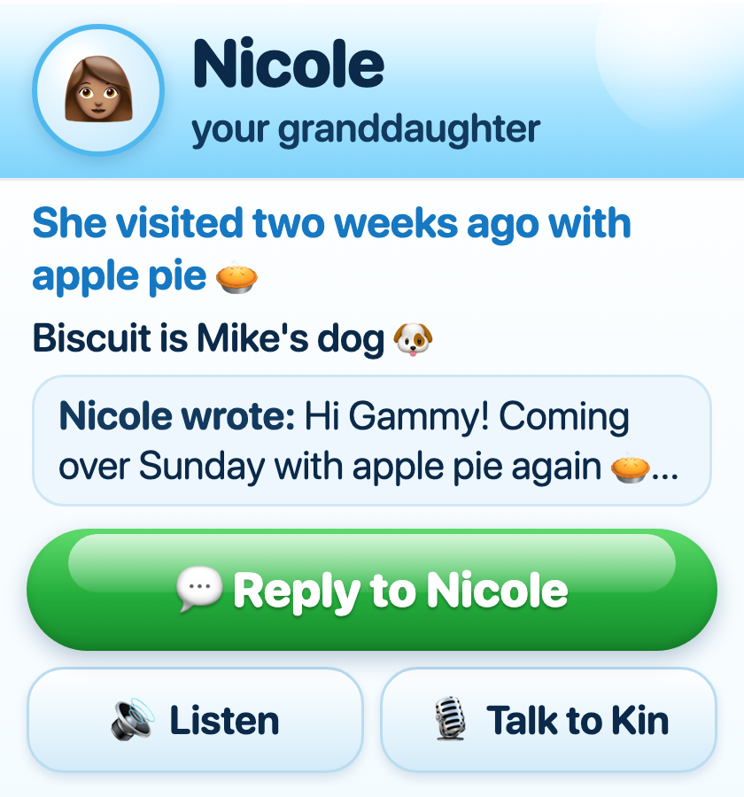
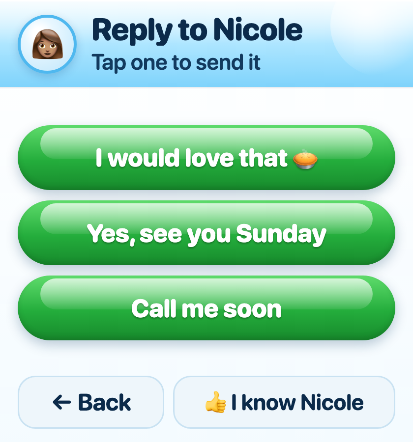
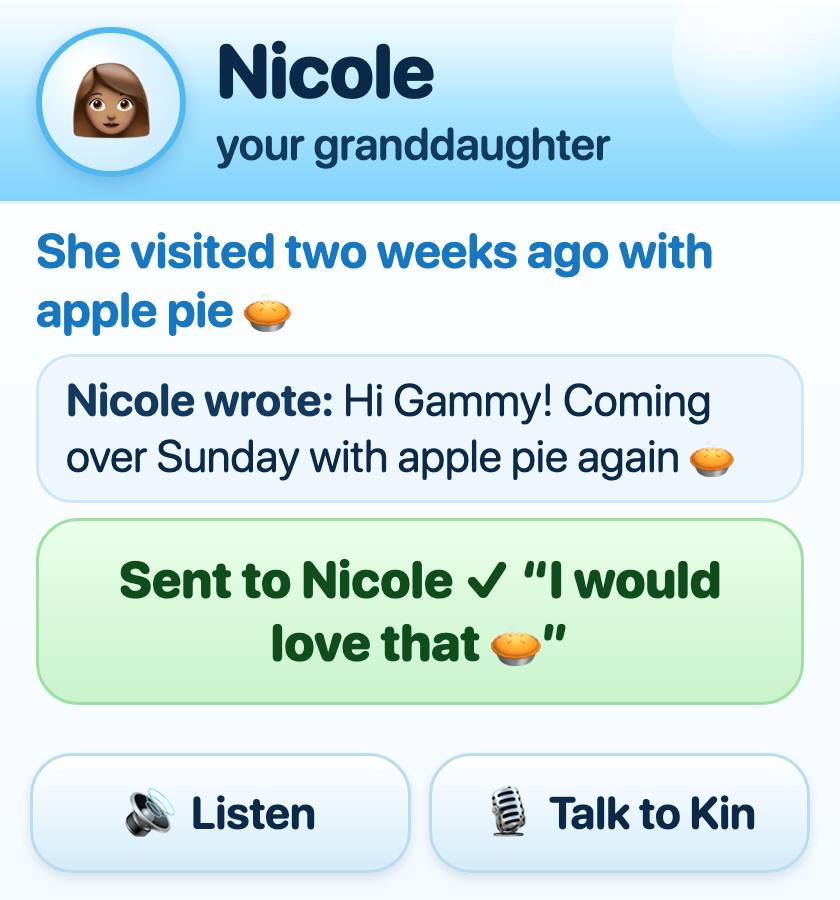
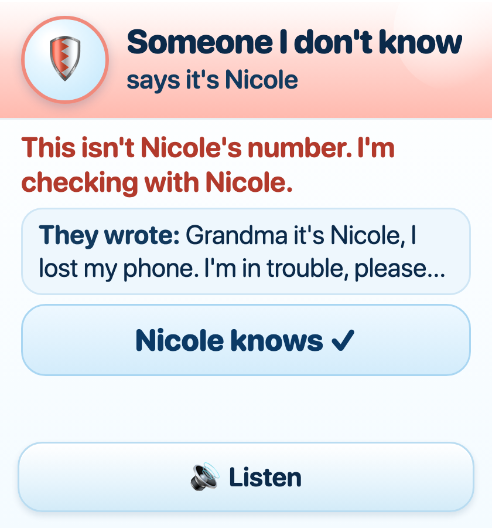
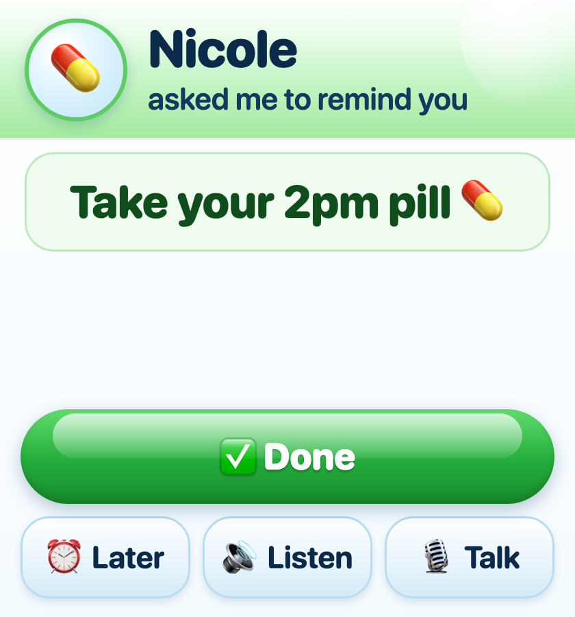
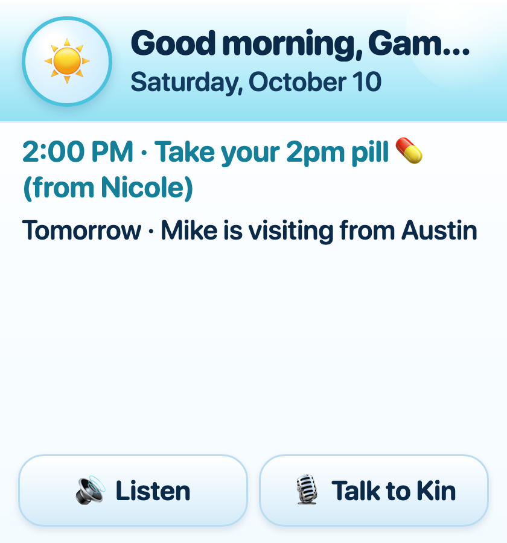

# Kin 💙




**Kin helps a grandmother living with memory loss know who's texting her, stay safe from scams, and get reminders from the people she loves, all inside iMessage and without anyone changing how they text her.**

Built in 24 hours at HackNC 2026 for the Photon AI Agent track. Built with Photon Spectrum, Gemini 3.5 Flash-Lite and ElevenLabs.

---

## The problem

- **7.4M Americans 65+ are living with Alzheimer's in 2026** (about 1 in 9), and **13M unpaid caregivers** gave 19B+ hours of care in 2025. **59%** of those caregivers report high or very high emotional stress. *(S1, Alzheimer's Association 2026 Facts & Figures)*
- **Scams find them by text.** Adults 60+ reported **$7.7B** in losses to the FBI in 2025, up 59% in a year *(S3)*. Scams that started with a text cost people **$470M** in 2024, five times the 2020 figure *(S5)*, and AI voice clones now power "grandparent scams" *(S6)*.
- **Not being able to place who's texting is isolating.** About 1 in 3 people with dementia live alone *(S24)*, and loneliness raises dementia risk by 31% *(S22)*. When Grandma can't tell who someone is, she gets anxious and stops replying.

## How it works

Grandma's family texts her exactly as before. Kin reads her real threads on the family Mac and sends her a **live card** in a separate "Kin" thread. Her real conversations are never touched.

| Job | What happens |
|---|---|
| **Recognize** | Nicole texts Grandma → a card shows *who* (name + relationship, as a statement), **one verified memory line**, the quoted message, and ≤ 3 one-tap replies. A tap sends the reply **as Grandma**, in Nicole's real thread. |
| **Protect** | An unknown number asks for gift cards or claims "it's Nicole, new number" → a calm red card ("Please don't send money or codes. I've let Nicole know."), links shown as untappable text, **Nicole gets an alert**, and Kin never replies to the sender. Nicole answers `SAFE` or `SCAM` and the same card updates. |
| **Remind** | Nicole texts Kin "remind Grandma to take her 2pm pill" → at 2pm a green card *from Nicole* with **✅ Done** / **⏰ In 10 minutes**. A tap (or a 👍 tapback) → Nicole gets "Grandma did it ✅". If there's no answer: a gentle nudge in the same card at T+30 min, then a text to Nicole at T+60. |
| **Listen** | 🔊 on every card plays an ElevenLabs `eleven_v4` read-aloud **inside the card**, with the text still on screen. |
| **Talk to Kin** | 🎙️ opens a voice conversation **inside the iMessage card** (ElevenLabs Conversational AI over WebRTC). Kin reads the message, offers a reply, reads it back, and sends only after she says "yes". |

**A short exchange**

```
Mike → Grandma (her real thread):   "Hi Mom! Biscuit says hi 🐶 Are you free Sunday?"

Kin → Grandma (card):              Mike · your son
                                Biscuit is Mike's dog 🐶
                                Mike wrote: "Hi Mom! Biscuit says hi 🐶 Are you free Sunday?"
                                [ Yes, I'm free! ❤️ ]  [ Call me Sunday ]
                                🔊 Listen    🎙️ Talk to Kin

Grandma taps "Yes, I'm free! ❤️"   → Mike receives it from Grandma's own number
                                → the card updates: "Sent to Mike ✓"
```

Family can also text Kin memories ("Remember: Mike's dog is Biscuit") or **photos with a caption**, which become photo memories on the dashboard's memory map.

## Architecture



## How we use each sponsor

### Photon Spectrum (the product lives here)
- **One process runs both providers.** The **local** provider (`@spectrum-ts/imessage-local`) watches Grandma's `chat.db` and sends replies *as her* with `space.send()`. The **cloud** provider (`spectrum-ts/providers/imessage`) is Kin's own line, which DMs her cards and texts the family.
- **Live mini-app cards.** Every card is an `app()` with a `layout` (caption and subcaption for the bubble) and a signed URL. When something changes (reply sent, reminder done, Nicole says it's a scam), Kin calls **`edit()` on the same bubble**, so messages never pile up.
- **Chat-native inputs:** a 👍/❤️ **tapback** on a reminder card marks it done. Grandma can text Kin "who is Mike?", "tell Nicole to call me", "done", or `1`/`2`/`3` to pick a reply, and she can send Kin **voice notes**.
- **Echo safety:** Kin's own cloud messages also land in Grandma's `chat.db`, so the router drops anything from `KIN_LINE_HANDLES`.

### Gemini 3.5 Flash-Lite (`gemini-3.5-flash-lite`, REST + JSON schema)
- **One structured-JSON call per incoming family message** (`assess_compose`) returns triage flags (trivial, question for her, stressful, long), mentions, scam score, **the memory pick**, ≤ 3 reply options, an optional summary or calm note, and a photo caption if one was sent.
- **Plain code decides every action.** Gemini only fills fields. `decide.ts` applies rules R1–R7 / Q1–Q3 / P1–P4, and `verifyMemoryLine()` checks that the memory id was one of the candidates and every capitalized name in the line is grounded in that memory or the sender's record. It also rejects quiz words and question marks. If a check fails, the card shows no memory line.
- **Vision:** family photos sent to Kin become photo memories. Names come **only from the caption text, never from faces**, and code enforces that.
- **Audio:** Grandma's voice notes are converted with `afconvert` and understood by Gemini (transcript + intent). A "reply" intent becomes a **"Send to Nicole?" card**, so nothing goes out without her tap.
- **Rules-only fallback:** 8 s timeout, 1 retry, a daily request budget (switches off at 90%), and `GEMINI_OFF=1`. Without Gemini, the regex scam check still protects her and cards still send with canned replies.
- A second, smaller call (`thread_facts`) learns durable facts ("Nicole started a new job") **only from threads with enrolled family**.

### ElevenLabs
- **Listen:** `eleven_v4` with delivery tags (`[warmly]`, `[calmly]`) makes an mp3 that plays **inside the card**. It's pre-made when the card is sent, cached per card and script, and served with HTTP range requests (Safari needs them). A voice note in the thread is the fallback.
- **Talk to Kin:** ElevenLabs Conversational AI over **WebRTC inside the iMessage card webview** (mic verified on device; "Open in Safari" fallback after a mic timeout). The server mints a short-lived conversation token, so the API key never reaches the phone, and it passes card context as dynamic variables.
- **Server tools that can only act after a spoken yes:** `send_reply`, `ask_family_to_call` and `mark_reminder_done` are webhook tools that call back into `/tools/*` with an `X-Kin-Secret` header (stored as an ElevenLabs workspace secret). The agent prompt requires a read-back and a clear "yes". The server then **re-checks** the card type and state, the text length, and blocks money, code and account words. `scripts/sync_agent.ts` pushes the prompt and tools.

## The never list, enforced in code

| # | Kin never… | Where it's enforced |
|---|---|---|
| 1 | Edits or hides a real message | The local provider is only used to read and to `space.send()` new replies. `edit()` is only called on Kin's own cards. |
| 2 | Sends as Grandma without her tap (or a spoken yes) | `sendAsAsha` is only reached from a card tap (`reply`, `send_voice_reply`) or the `send_reply` tool. Taps are idempotent (`replied` state). |
| 3 | Sends money or codes, or replies to an unknown sender | Reply options with `$`, money, gift, code or password are dropped. The tools block money, code and account words and 4+ digit numbers. `onUnknownToAsha` has no send-to-sender path. Links are defanged (`usps-help[.]top`). |
| 4 | Pretends to be family | Kin has its own line and name. Family alerts are written in Kin's voice. The voice agent prompt says "I'm Kin". |
| 5 | Invents a memory | `verifyMemoryLine()` (candidate id, grounded names, no quiz words). Photo names come from the caption only. |
| 6 | Gives medical advice | Reminders deliver the family's own words. Prompts forbid medical advice. Off-topic → "Nicole can help." |
| 7 | Reports her general activity | The only family messages are scam alerts, reminder done or missed, and "she'd like a call". There's no activity code path. |
| 8 | Learns from non-family threads | `learnFromThread` requires `person.enrolled`. Unknown senders never reach it. `TEST_SENDERS` gates the local stream. |
| 9 | Chit-chats | Anything out of scope gets one fixed line: "I can help with your family and messages." |

## Dementia-informed design

- **Statements, not quizzes.** The card says "Mike · your son" and never "Do you know who this is?" or "Remember when…?" *(S14, S2, S12)*. This is enforced by the `BANNED` regex in `memory.ts`.
- **At most 3 one-tap replies and few controls per screen; one idea per screen** *(S10, S11, S30)*.
- **Read-aloud always comes with on-screen text**, using her name: hearing loss is disabling for 55% of people 75+ *(S20, S10, S11)*.
- **Reminders in the family's words, credited to them,** with one big Done and no blame *(S29, S25)*. The escalation timings are a design choice to test, not evidence *(S25, S26, S31)*.
- **Scams:** hold the message back up front, disable links, never reply, alert the caregiver, never shame her *(S5, S6, S9, S3, S4)*.
- **Same patient wording every time she reopens a card** *(S14, S15)*. Language: "person living with memory loss" *(S16)*.

## Engineering notes (what actually broke)

- **`@photon-ai/imessage-kit@3.0.0` crashed on macOS 15's `chat.db`:** `message.ck_chat_id` doesn't exist there. We patched it to select `NULL` (`patches/`, via `bun patch`).
- **The WAL `fs.watch` missed a real message.** We added a 1.5 s poll fallback and `IMK_START_ROWID`, so Kin resumes from the last saved ROWID after a restart and loses nothing.
- **Photon Pro's shared pool can only message phone numbers, and only ones that have texted their Kin line first.** Emails were rejected even after registering. That decided our device layout: Grandma is an iPhone.
- **The card webview is 280×300 (149×58 in the bubble).** The UI is one idea per screen (who + message, then replies), with Listen and Talk in a consistent row and no scrolling. `bun tests/preview_cards.ts` renders every card state at the real size.
- **Listen plays in the card.** iOS needs HTTP range requests (`206 Partial Content`) for `<audio>`, and audio is prefetched on send so the first tap is instant.
- **Taps are not Spectrum events.** The card page POSTs `/card/:id/act` with an HMAC token, and the server runs the action and `edit()`s the bubble.
- **The mic prompt can hang in the webview.** Talk to Kin times out after a few seconds and offers "Open in Safari".

## Setup and run (macOS)

```bash
bun install                         # applies the imessage-kit patch
cp .env.example .env                # then fill in the keys below
bun src/seed.ts                     # made-up demo family (Grandma, Nicole, Mike, Linda)
cloudflared tunnel --url http://localhost:3000   # copy the https URL into PUBLIC_BASE_URL
bun scripts/sync_agent.ts           # push the Talk to Kin prompt + tools to ElevenLabs
bun src/main.ts                     # Kin; dashboard at http://localhost:3000/dash
```

The Mac needs Messages signed into Grandma's Apple ID and **Full Disk Access** for the terminal (to read `chat.db`). Grandma's iPhone needs the "Spectrum – Apps in Messages" iMessage app.

**`.env` keys** (no values are committed):
`SPECTRUM_PROJECT_ID`, `SPECTRUM_PROJECT_SECRET`, `GRANDMA_HANDLE`, `CAREGIVER_HANDLE`, `KIN_LINE_HANDLES`, `TEST_SENDERS`, `GEMINI_API_KEY`, `ELEVENLABS_API_KEY`, `ELEVENLABS_AGENT_ID`, `ELEVENLABS_TOOL_SECRET`, `ELEVENLABS_VOICE_ID` (optional), `KIN_SIGNING_SECRET`, `PUBLIC_BASE_URL`. Demo options: `DEMO_FAST_CLOCK=1` (1 minute → 2 s), `DEMO_REMINDER_SEC`, `QUIET_HOURS_ENABLED`, `GEMINI_OFF=1`.

## Tests

```bash
bun tests/replay.ts         # whole pipeline, fake transport, real Gemini: Recognize, Protect, Remind, memories, photo memories, voice replies
bun tests/agent_tools.ts    # Talk to Kin webhook tools: auth, card checks, blocked words, idempotency
bun tests/preview_cards.ts  # every card state at 280×300 → data/preview/grid.html
```

Device smoke tests from the build (local listen, cloud card, bridge, Gemini, ElevenLabs, card round trip) are in `tests/0*.ts`.

## Privacy

- **Runs on the family's Mac.** SQLite and media stay in `data/`. The dashboard is localhost only.
- **Only enrolled family threads are read for memories.** Unknown senders are only checked for scams.
- Card URLs are **HMAC-signed**, and tool endpoints need a shared secret.
- The demo uses **made-up data only**, because it runs on Gemini's free tier. A real deployment would use the paid tier, which isn't used for training.

## What's next

- **Photon Business plan → Kin joins the family group chat** as a member (rule G1: speak only when someone addresses her). Group messages are deliberately ignored in v1.
- **A hosted version**, so families without a Mac can use Kin.
- **Real phone calls** through Photon SIP, reusing the same ElevenLabs agent and tools, for the T+45 reminder step and "call me".
- A consent flow in chat (Kin asks Grandma "Is that okay?" before anything starts), the ☀️ morning card, and co-design sessions with people living with dementia and their caregivers before any real launch *(S32, S30)*.


## Also built
- **Voice notes from Grandma** → a "Send to Nicole?" confirm card; nothing sends without her tap.
- **👍 I know Nicole** → Kin steps back for people she recognizes (but still helps with questions, unfamiliar names and stress).
- **☀️ Today card** at 8 AM with today's reminders and upcoming visits.
- **Demo robustness:** a Gemini-off fallback test, a keep-alive runner (`scripts/run.sh`), and dashboard Reset / Test reminder / Today buttons.

## Gallery
| | | |
|---|---|---|
|  |  |  |
|  |  |  |

